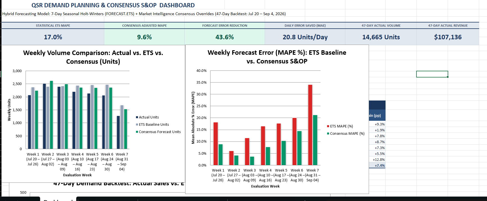

# QSR Demand Planning & Consensus S&OP

A demonstration project focused on **best practices in S&OP Demand Management** for a Quick Service Restaurant (QSR).

This project shows how to combine a statistical forecasting baseline with structured market intelligence overrides to create a more accurate consensus demand plan.

## Project Focus
- Hybrid demand planning (Statistical + Judgment)
- Consensus S&OP process
- Out-of-sample forecast accuracy evaluation
- Documented override logic based on real operational drivers

## Key Approach
1. **Statistical Baseline**  
   7-day seasonal Holt-Winters (ETS) model trained on historical POS data.

2. **Consensus Overrides**  
   Planner adjustments based on market intelligence such as:
   - Weather conditions
   - Local events and festivals
   - Movie releases and external demand drivers
   - Operational factors (outages, disruptions)

3. **Performance Measurement**  
   47-day out-of-sample backtest comparing pure statistical forecast vs final consensus plan.

## Results Summary
| Metric                        | Value      |
|------------------------------|------------|
| Evaluation Period            | 47 days    |
| Total Actual Volume          | 14,665 units |
| Baseline (ETS) MAPE          | 17.01%     |
| Consensus Plan MAPE          | 9.60%      |
| Relative Error Reduction     | ~43.6%     |

## What’s Included
- Executive Dashboard
- Daily Demand Planning & Override Log
- Historical Baseline + Exception Log
- 2-Year Raw POS History

## Purpose
This is a **portfolio / demonstration project** designed to showcase practical understanding of:
- Demand forecasting fundamentals
- Consensus S&OP process
- Override documentation discipline
- Forecast accuracy measurement

It is not intended as a live daily ordering tool, but as a structured example of S&OP demand management best practices.

## How to Review
1. Start with the **Executive Dashboard** for high-level results
2. Review the **Demand Planning Model** sheet for daily forecasts and override reasons
3. Check the historical and exception logs for data context

## Project Screenshots

### Executive Dashboard

### Forecast Accuracy Tracker

### Multiple Inputs of Demand

